# Aniimo 家園工具

《Aniimo》的輔助工具：家園農場總覽、設施與伊莫管理、訂單與倉庫、商店與回購、利潤試算、每日 / 每週提醒、搶蛋大作戰戰績等。

## 下載

到 **[Releases（最新版）](https://github.com/a8761207/AniimoHomeTool-Release/releases/latest)** 下載 `AniimoHomeTool-v版本.exe`，直接執行即可，不用安裝。

## 使用需求

- **所有資料和功能，一律要遊戲開著才能使用**
- 本工具**不會連線到遊戲伺服器**、**不會傳送任何資料給遊戲伺服器**，也**不會修改遊戲的安裝檔案**
- 本工具是第三方輔助工具，與遊戲官方無關，請自行評估後使用
- Windows 10 / 11（64 位元）
- 需要授權帳號登入（第一次開啟可以註冊，或使用作者提供的帳號）
- 程式啟動時會要求**系統管理員權限**

## 第一次執行

- 執行檔沒有數位簽章，Windows 可能顯示「Windows 已保護您的電腦」：
  點「其他資訊」→「仍要執行」
- 每個版本的 Release 頁面都附 VirusTotal 掃毒報告；不放心的話，可以比對下載檔案的 SHA256 跟報告上的是否相同
  （PowerShell：`Get-FileHash 檔名`）

## 內容預覽

### 家園

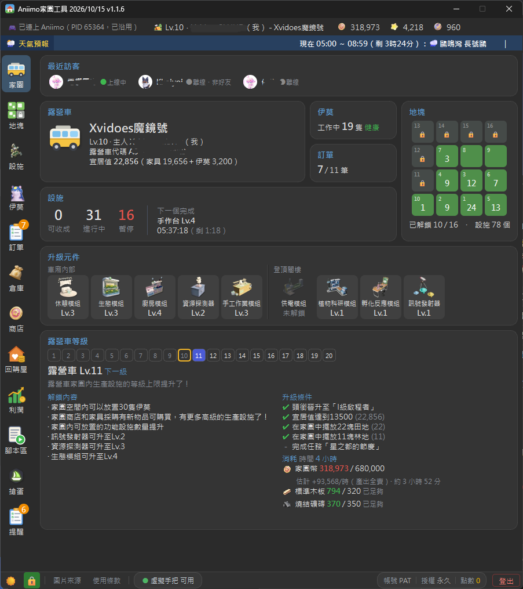

### 地塊

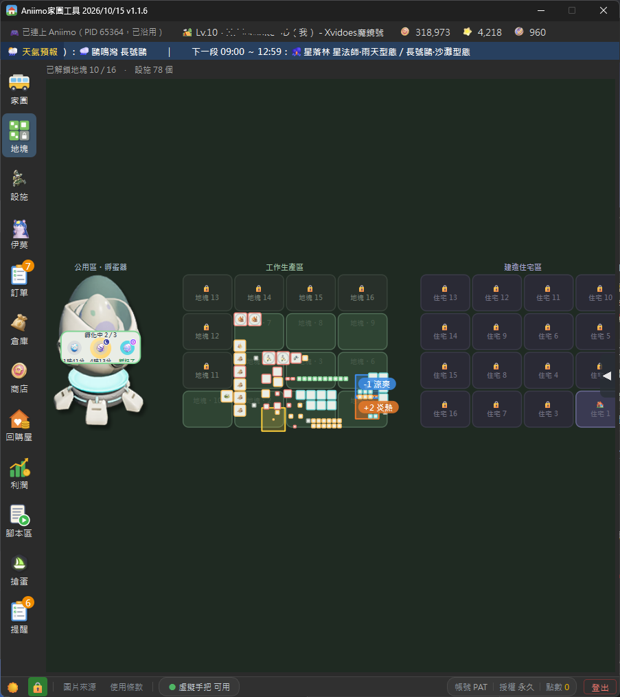

### 設施

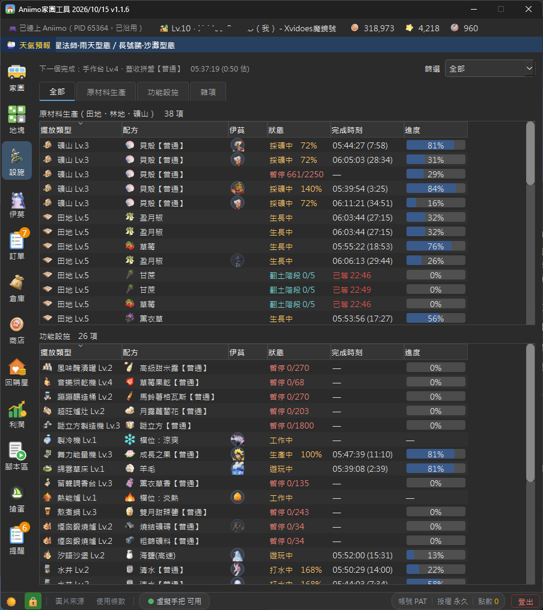

### 伊莫

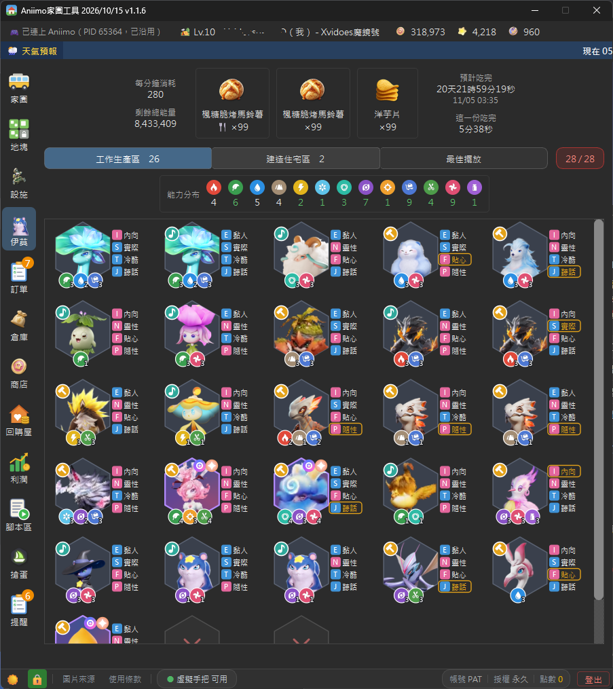

### 訂單

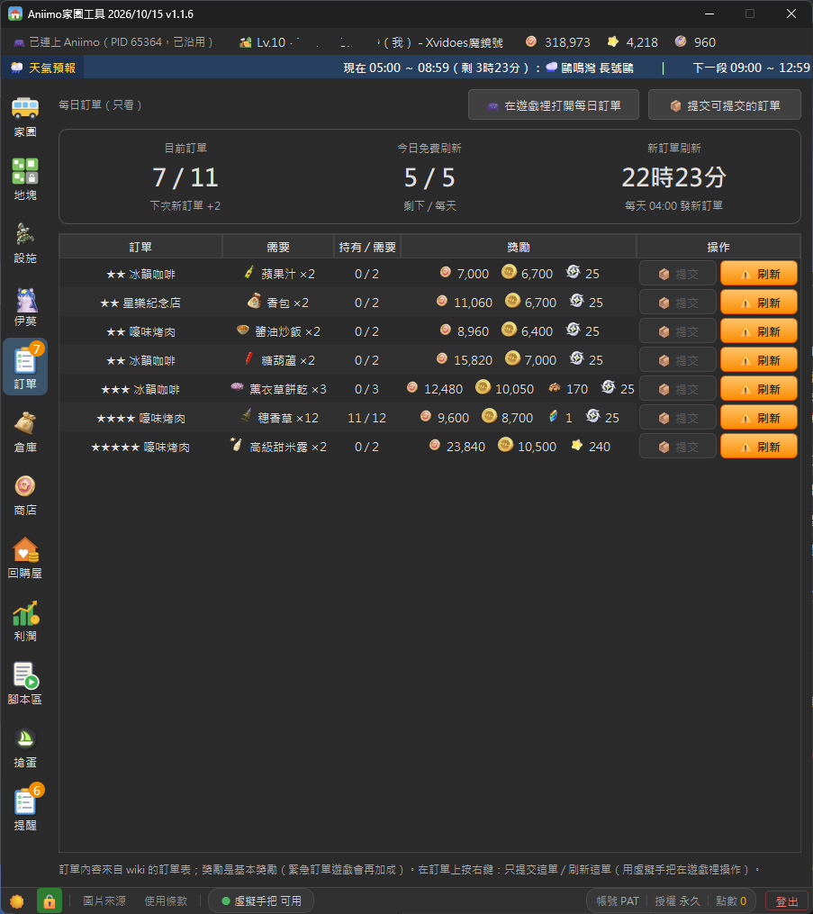

### 倉庫

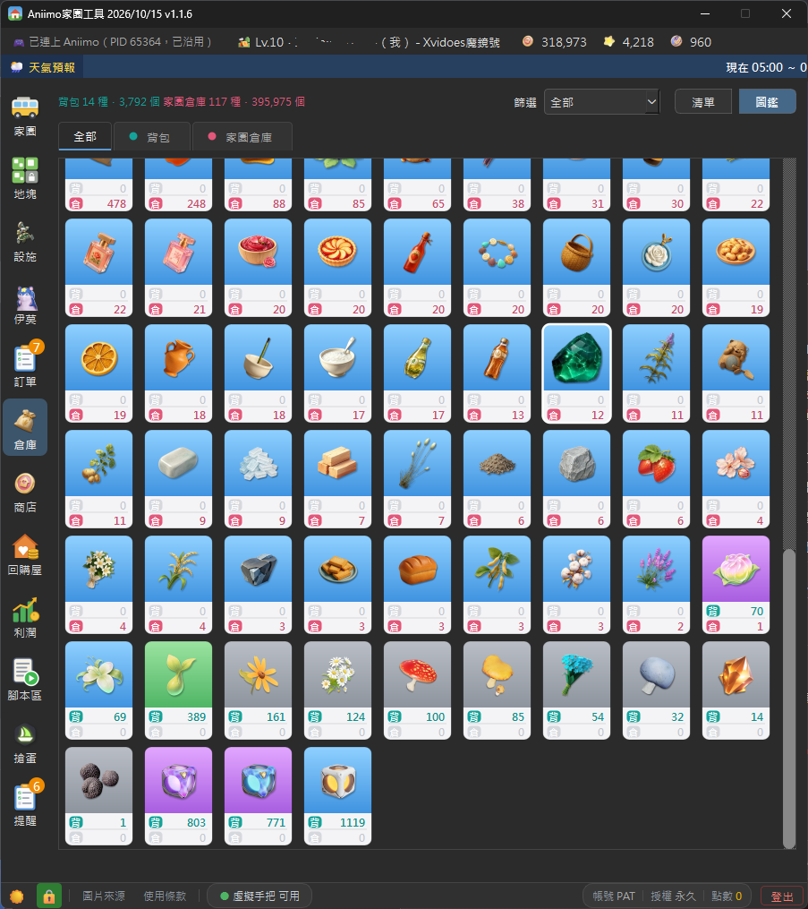

### 回購屋

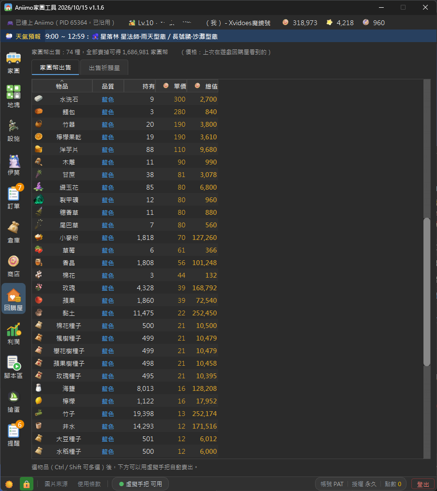

### 利潤

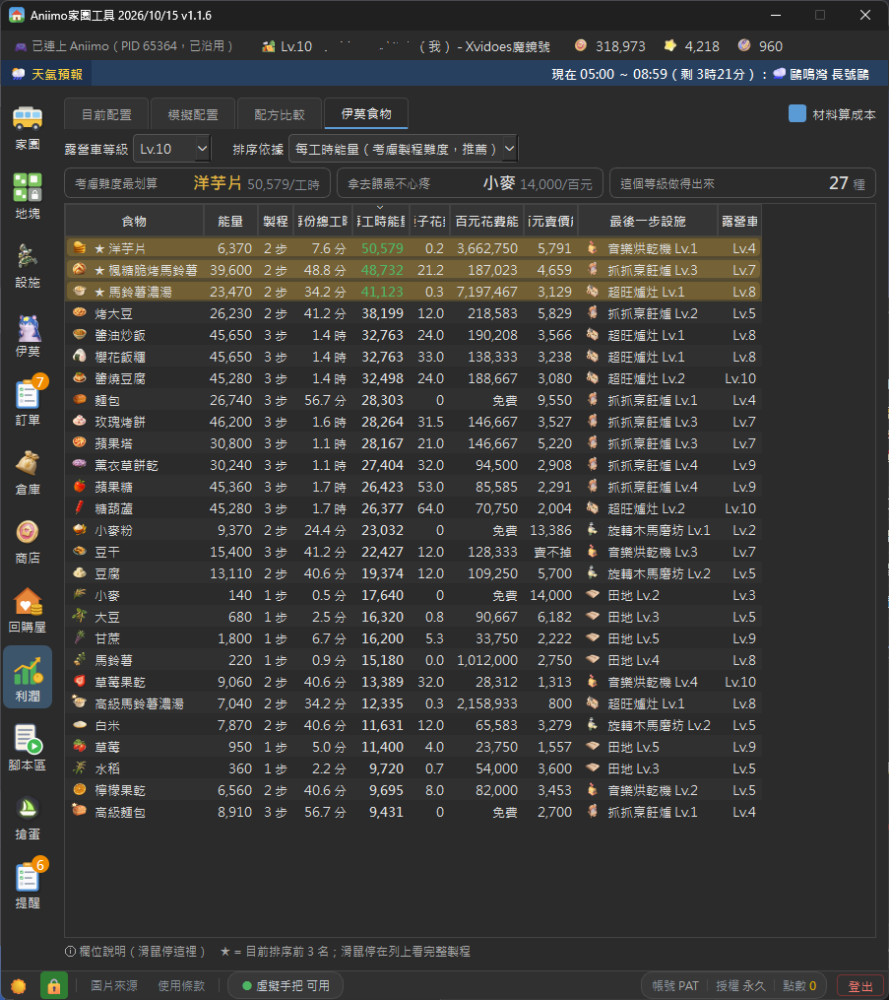

### 搶蛋

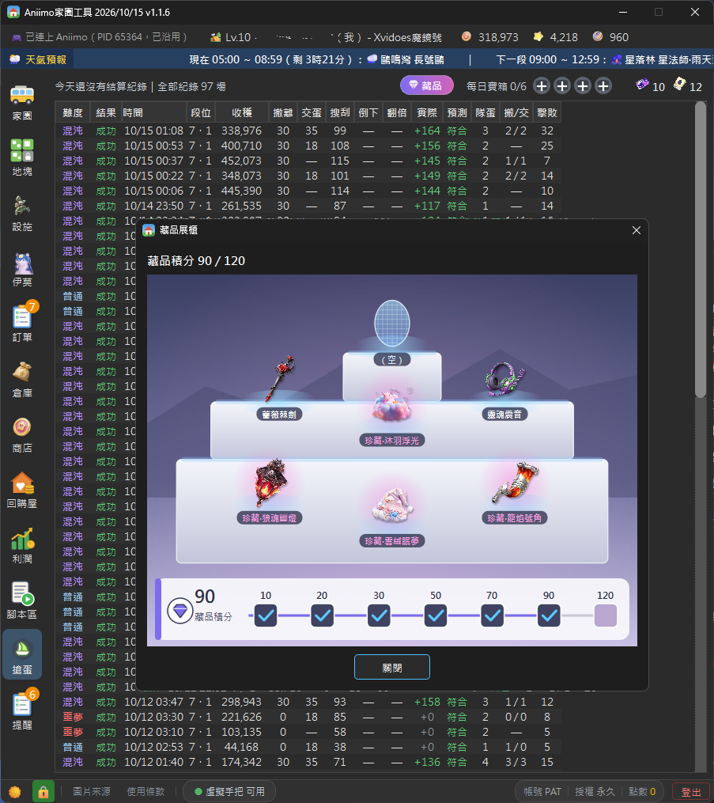

### 腳本區

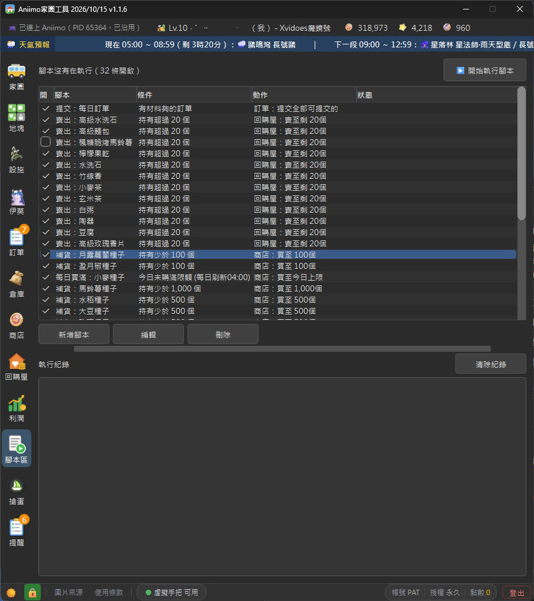

### 提醒

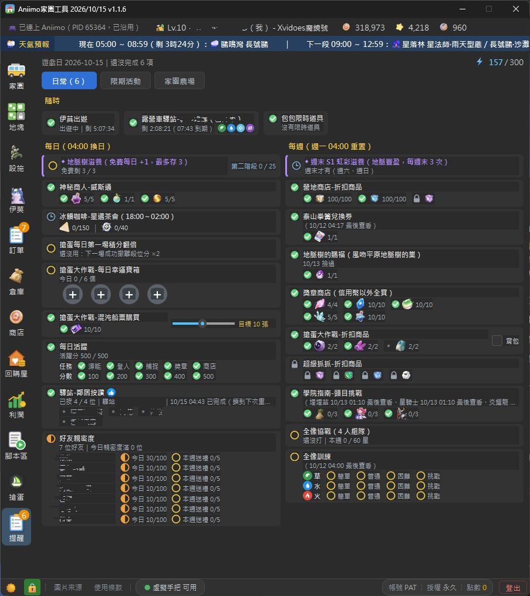

---

## 支持作者

喜歡這個工具的話，想支持作者，可以考慮加入 **[遊戲聯合公國 Discord](https://discord.gg/nTE6CBb)** 幫我們擴展人數。
這是一個廣納各種遊戲的交流社區，不侷限單一遊戲，族群偏向上班族較多，不想要加入的話也不勉強。

也可以透過 Ko-fi 贊助作者，你的支持是持續更新的動力：

